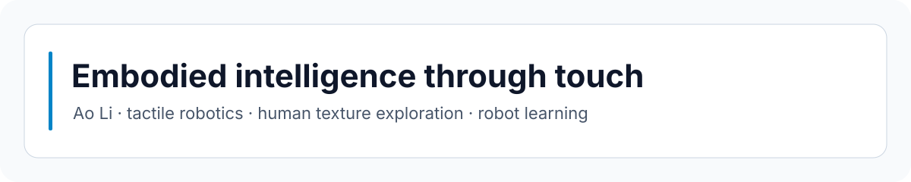

# Ao Li

I am a PhD student in Engineering Mathematics at the University of Bristol.
My work sits around tactile robotics, neuromorphic touch, embodied intelligence, and the small research tools that make experiments easier to reason about.

The part I keep coming back to is simple: touch is messy, fast, and physical. A robot still has to turn it into something it can use.

## Current Focus

| Area | What I am exploring |
| --- | --- |
| Tactile robotics | How contact, force, speed, and surface texture change the way a hand should move. |
| Neuromorphic touch | Event-based sensing, tactile signals, and the link between raw contact and useful perception. |
| Embodied intelligence | Perception-action loops, robot behavior, and the gap between a clean demo and the real world. |
| Research tooling | Notes, experiments, scripts, and AI-assisted workflows that help me think more clearly. |

## Featured Work

| Project | Notes |
| --- | --- |
| [Human-Texture-Exploration-Experiment](https://github.com/aoli0919/Human-Texture-Exploration-Experiment) | Research code around human touch, texture exploration, force, and speed. |
| [2023BristolRobotics](https://github.com/aoli0919/2023BristolRobotics) | Dissertation-related robotics code from Bristol. |
| [NMA_Course](https://github.com/aoli0919/NMA_Course) | Computational neuroscience coursework and notes. |
| [aoli0919.github.io](https://github.com/aoli0919/aoli0919.github.io) | Personal website source. |

## Research Interests

- tactile robotics and neuromorphic touch
- human texture exploration and contact behavior
- embodied AI and robot learning
- computational neuroscience
- practical research workflows

## Tools I Use

`Python` | `Jupyter` | `NumPy` | `pandas` | `scikit-learn` | `matplotlib` | `Markdown` | `LaTeX`

## GitHub Snapshot

## Notes

I like building small systems that make unclear things easier to test: a cleaner experiment log, a sharper plot, a better question, or one script that removes a little friction from tomorrow.
